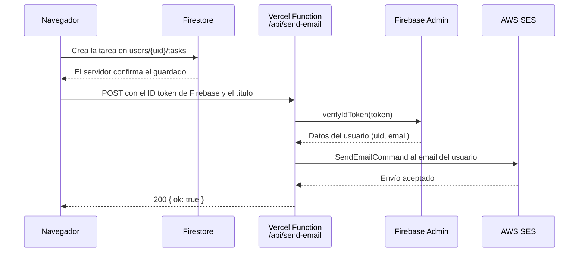
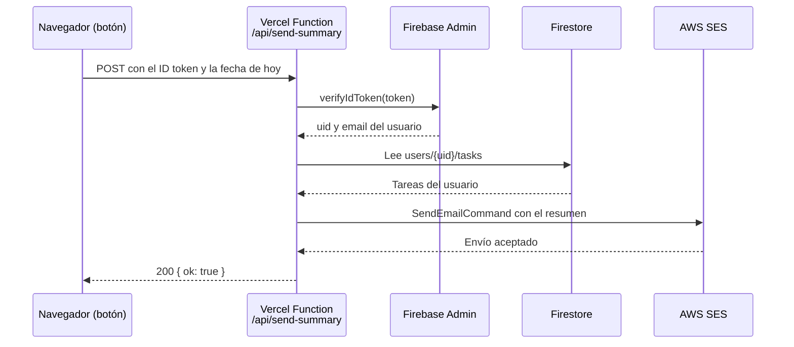

# MateCode Tareas

Aplicación web SPA para que los empleados de una pequeña empresa gestionen sus tareas diarias de forma organizada, persistente y accesible desde cualquier dispositivo. Proyecto Integrador del Módulo 4 (Henry).

- **Producción:** https://proyecto-m4-joaquin-suarez.vercel.app
- **Repositorio:** https://github.com/joaco2003/ProyectoM4_JoaquinSuarez

> **Importante para probar los emails:** la cuenta de AWS SES está en *modo sandbox*, por lo que solo entrega mails a direcciones **registradas (verificadas) en AWS SES**. Antes de usar el botón "Enviar resumen por email", el email del usuario tiene que estar registrado en SES. Ver la sección [6.3](#63-limitación-conocida-sandbox-de-ses-y-registro-previo-del-email) con los pasos.

---

## 1. Descripción del proyecto

MateCode Tareas permite a cada usuario registrarse, iniciar sesión y administrar su propia lista de tareas. Los datos se guardan en la nube, así que cada persona ve solo lo suyo desde cualquier dispositivo. Al crear una tarea, la app envía un email de confirmación, y desde un botón se puede pedir por email un resumen del estado de todas las tareas.

### Funcionalidades

**Autenticación**
- Registro con email y contraseña, o con Google.
- Login y logout.
- Rutas privadas: sin sesión no se pueden ver las tareas (redirige a `/login`).
- Mensajes claros para los errores de autenticación (email en uso, contraseña débil, credenciales inválidas, etc.).

**Gestión de tareas (por usuario autenticado)**
- Crear tarea (título + descripción), listar, editar, eliminar y marcar como completada.
- Persistencia en Firestore, con actualización en tiempo real.
- Cada usuario solo puede ver y modificar sus propias tareas (reglas de seguridad de Firestore).

**Notificaciones por email (AWS SES)**
- Email de confirmación al crear una tarea.
- Botón **"Enviar resumen por email"**: manda al usuario un resumen con el total de tareas, las pendientes (ordenadas por prioridad y fecha, marcando las vencidas) y las completadas.
- Ambos mails se envían con AWS SES a través de Vercel Functions, y siempre al email del usuario autenticado.

**Extras (Extra Credit)**
- Filtros: todas, pendientes o completadas.
- Drag & drop para reordenar tareas (dnd-kit), con el orden guardado en Firestore.
- Prioridad (alta, media, baja) y fecha de vencimiento, con orden por prioridad o por fecha y marca visual de tareas vencidas.
- Diseño moderno con soporte automático de modo oscuro.

### Stack

| Capa | Tecnología |
|---|---|
| Frontend | React 18 + TypeScript + Vite |
| Navegación | React Router v6 |
| Backend as a Service | Firebase Authentication + Firestore |
| Emails | AWS SES, invocado desde Vercel Functions |
| Drag & drop | dnd-kit |
| Tests | Vitest + React Testing Library |
| Deploy | Vercel |

---

## 2. Decisiones arquitectónicas

**Arquitectura por capas.** El código separa responsabilidades para que cada parte sea fácil de entender y de testear:

- `components/`: componentes reutilizables y presentacionales (`TaskForm`, `TaskItem`, `SortableTaskItem`, `ProtectedRoute`).
- `pages/`: pantallas que arman la interfaz (`AuthPage`, `TasksPage`).
- `hooks/`: lógica de estado y datos (`useTasks`).
- `services/`: acceso a Firestore y a la API de emails (`tasks.ts`, `notify.ts`, `summary.ts`). Es la única capa que conoce Firebase y las rutas de la API.
- `context/`: estado global de la sesión (`AuthContext`).
- `utils/`: funciones puras sin dependencias de React o Firebase (`taskView.ts`, `authErrors.ts`).
- `types.ts`: tipos compartidos de TypeScript (`Task`, `TaskFormValues`, `Priority`, etc.).
- `api/`: funciones serverless de Vercel para enviar emails (`send-email.ts`, `send-summary.ts`).

**Firebase como BaaS.** El enunciado pide una solución rápida, escalable y basada en servicios administrados. Firebase Auth resuelve el registro y el login (incluido Google) sin servidor propio, y Firestore da persistencia y actualización en tiempo real con `onSnapshot`.

**Modelo de datos: subcolección por usuario.** Las tareas viven en `users/{uid}/tasks/{taskId}`. Así la regla de seguridad es simple y difícil de romper: solo el dueño (`request.auth.uid == userId`) puede leer o escribir en su subcolección. Además evita consultas con filtro por usuario y los índices compuestos que haría falta crear.

**Seguridad en el servidor, no solo en la interfaz.** Ocultar rutas en el frontend no alcanza. Las reglas de Firestore (`firestore.rules`) validan quién accede y también el formato de los datos (título obligatorio de hasta 100 caracteres, descripción de hasta 500, `completed` booleano).

**El email se envía desde el servidor.** AWS SES no se puede llamar de forma segura desde el navegador, porque las credenciales de AWS quedarían expuestas en el código que se descarga. Por eso el frontend llama a `/api/send-email` o `/api/send-summary`, y esas funciones (que corren en Vercel y son las únicas que tienen las claves) validan al usuario y envían el mail. El destinatario siempre es el email del usuario autenticado, que sale del token verificado y no del body de la petición, así nadie puede usar los endpoints para mandar correo a terceros.

**El resumen lo arma el servidor.** `/api/send-summary` no recibe las tareas desde el navegador: las lee de Firestore con Firebase Admin usando el `uid` del token verificado. Así el contenido del mail no se puede falsear desde el cliente.

**Un hook para los datos (`useTasks`).** Concentra la suscripción a Firestore, el CRUD, el orden manual y el aviso por email. `TasksPage` queda como una pantalla que solo se ocupa de la interfaz. Esto también permitió testear la lógica de datos con los servicios mockeados.

**Acciones sin bloqueo de la interfaz.** Firestore escribe primero en local y confirma con el servidor después. La interfaz no espera esa confirmación: la lista se actualiza al instante, y si el servidor rechaza la operación se muestra un mensaje de error. El email de confirmación se envía solo después de que el servidor confirma el guardado.

**Orden manual con un campo `order`.** Para el drag & drop cada tarea guarda su posición. Las tareas nuevas reciben un valor negativo basado en la fecha para quedar arriba, y al reordenar se guardan las posiciones con un `writeBatch` atómico. Las tareas creadas antes de agregar estos campos se normalizan al leerlas (prioridad "media", sin vencimiento).

**Lógica de vista como funciones puras.** Filtrar, ordenar y detectar tareas vencidas está en `utils/taskView.ts`, sin dependencias externas, lo que las hace fáciles de testear.

**Mobile first y accesibilidad.** Los estilos arrancan para pantallas chicas y se amplían con media queries. Los formularios usan `label`, los errores usan `role="alert"`, los mensajes de éxito usan `role="status"`, los botones de arrastre tienen `aria-label` y el drag & drop funciona también con teclado.

### Estructura del proyecto

```
.
├── api/
│   ├── send-email.ts          # Vercel Function: aviso de tarea creada (SES)
│   └── send-summary.ts        # Vercel Function: resumen de todas las tareas (SES)
├── src/
│   ├── components/            # TaskForm, TaskItem, SortableTaskItem, ProtectedRoute (+ tests)
│   ├── context/               # AuthContext
│   ├── hooks/                 # useTasks (+ test)
│   ├── pages/                 # AuthPage, TasksPage
│   ├── services/              # tasks.ts (Firestore), notify.ts y summary.ts (API de emails)
│   ├── utils/                 # taskView.ts, authErrors.ts (+ tests)
│   ├── firebase.ts            # Inicialización de Firebase
│   ├── types.ts
│   ├── App.tsx                # Rutas
│   └── main.tsx
├── firestore.rules            # Reglas de seguridad
├── vercel.json                # Rewrites para la SPA
├── .env.example               # Plantilla de variables de entorno
└── package.json
```

---

## 3. Instrucciones de instalación

### Requisitos
- Node.js 18 o superior y npm.
- Un proyecto de Firebase con **Authentication** (Email/Password y Google) y **Firestore** habilitados.

### Pasos

```bash
# 1. Clonar el repositorio
git clone https://github.com/joaco2003/ProyectoM4_JoaquinSuarez.git
cd ProyectoM4_JoaquinSuarez

# 2. Instalar dependencias
npm install

# 3. Crear el archivo de variables de entorno
cp .env.example .env.local
#    y completar las variables VITE_FIREBASE_* (ver sección 4)

# 4. Levantar el servidor de desarrollo
npm run dev
```

La app queda en `http://localhost:5173`.

### Configuración de Firebase
1. En la [consola de Firebase](https://console.firebase.google.com) creá un proyecto y registrá una app web para obtener la configuración.
2. En **Authentication → Método de acceso**, habilitá *Correo electrónico/contraseña* y *Google*.
3. Creá la base de datos en **Firestore Database**.
4. En **Firestore → Reglas**, pegá el contenido de `firestore.rules` y publicalo.
5. En **Authentication → Configuración → Dominios autorizados**, agregá tu dominio de Vercel.

### Scripts

| Comando | Qué hace |
|---|---|
| `npm run dev` | Servidor de desarrollo (solo frontend) |
| `npm run build` | Verifica tipos con `tsc` y genera el build de producción |
| `npm run preview` | Sirve el build localmente |
| `npm test` | Ejecuta los tests una vez |
| `npm run test:watch` | Tests en modo watch |

> **Nota:** `npm run dev` no ejecuta la carpeta `api/`, así que en local no se envían emails. Para probarlos en local se puede usar `npx vercel dev`, o probar directamente en la versión desplegada.

### Tests

```bash
npm test
```

Cubren: validación y envío del formulario, acciones de cada tarea (completar, editar, eliminar), protección de rutas, traducción de errores de autenticación, el hook `useTasks` (carga, creación con email y manejo de errores) y las funciones de filtrado y orden.

---

## 4. Variables de entorno necesarias

Hay dos grupos. Las `VITE_*` van en el frontend y no son secretas (la configuración web de Firebase es pública por diseño; la seguridad la dan las reglas de Firestore). Las demás son **secretas** y solo las usan las funciones de la carpeta `api/` en el servidor.

El archivo `.env.example` es la plantilla. **Nunca se sube `.env.local` a Git** (está en `.gitignore`).

| Variable | Dónde se usa | Descripción |
|---|---|---|
| `VITE_FIREBASE_API_KEY` | Frontend | API key de la app web de Firebase |
| `VITE_FIREBASE_AUTH_DOMAIN` | Frontend | Dominio de autenticación de Firebase |
| `VITE_FIREBASE_PROJECT_ID` | Frontend | ID del proyecto de Firebase |
| `VITE_FIREBASE_STORAGE_BUCKET` | Frontend | Bucket de storage de Firebase |
| `VITE_FIREBASE_MESSAGING_SENDER_ID` | Frontend | Sender ID de Firebase |
| `VITE_FIREBASE_APP_ID` | Frontend | ID de la app web |
| `FIREBASE_PROJECT_ID` | Servidor | Proyecto de la cuenta de servicio (Firebase Admin) |
| `FIREBASE_CLIENT_EMAIL` | Servidor | Email de la cuenta de servicio |
| `FIREBASE_PRIVATE_KEY` | Servidor (secreta) | Clave privada de la cuenta de servicio |
| `AWS_REGION` | Servidor | Región de SES (en este proyecto `us-east-2`) |
| `AWS_ACCESS_KEY_ID` | Servidor (secreta) | Clave de acceso del usuario IAM |
| `AWS_SECRET_ACCESS_KEY` | Servidor (secreta) | Clave secreta del usuario IAM |
| `SES_FROM_EMAIL` | Servidor | Remitente, verificado en SES |

Las variables del servidor se cargan en **Vercel → Settings → Environment Variables**. Las secretas se guardan con el tipo *Secreto*. Después de cambiar variables hay que hacer un **Redeploy** para que se apliquen.

---

## 5. URL de producción

https://proyecto-m4-joaquin-suarez.vercel.app

Cada `push` a la rama `main` dispara un deploy automático en Vercel. El archivo `vercel.json` redirige todas las rutas a `index.html`, así la SPA funciona al recargar en cualquier ruta (por ejemplo `/login`).

---

## 6. Flujo de envío de emails

### 6.1 Email de confirmación al crear una tarea



1. El usuario crea una tarea. `useTasks` la guarda en Firestore.
2. Cuando Firestore confirma el guardado, el frontend llama a `POST /api/send-email` con el **ID token** de Firebase en el header `Authorization: Bearer ...` y el título de la tarea.
3. La función verifica el token con Firebase Admin. Si es inválido responde `401`.
4. Toma el **email del token** (no del body) y valida el título (obligatorio, máximo 100 caracteres, escapado para HTML).
5. Envía el mail con `SendEmailCommand` de AWS SES, desde `SES_FROM_EMAIL`.
6. Si el envío falla, el frontend solo lo registra en consola: no bloquea ni rompe la creación de la tarea.

### 6.2 Resumen de todas las tareas por email



1. El usuario toca **"Enviar resumen por email"** en la lista de tareas.
2. El frontend llama a `POST /api/send-summary` con el **ID token** de Firebase y su fecha local (para detectar tareas vencidas).
3. La función verifica el token. Si es inválido responde `401`.
4. Lee las tareas desde Firestore con Firebase Admin, usando el `uid` del token (el contenido no viene del cliente), y arma el resumen: total, pendientes (por prioridad y fecha, con las vencidas marcadas) y completadas. Todo el texto se escapa para HTML.
5. Envía el mail con AWS SES **solo al email del usuario autenticado**.
6. La interfaz muestra un mensaje de éxito o el error que devuelve el servidor.

### 6.3 Limitación conocida: sandbox de SES y registro previo del email

Las cuentas nuevas de AWS están en **modo sandbox**: SES solo envía a direcciones que estén **registradas (verificadas) como identidad en AWS SES**. Por eso, **antes de usar los botones de email, el email del usuario tiene que estar registrado en AWS SES**.

**Cómo registrar un email en SES (hay que hacerlo una vez por dirección):**

1. Entrar a la consola de AWS → **Amazon SES**, en la región `us-east-2` (Ohio).
2. Ir a **Configuration → Identities → Create identity**.
3. Elegir **Email address**, escribir el email con el que se inicia sesión en la app y crear la identidad.
4. AWS manda un mail de verificación a esa dirección: abrirlo (revisar también Spam) y hacer clic en el enlace.
5. Cuando la identidad figura como **Verified**, el botón ya envía el resumen a ese email.

**Registro automático desde la app:** si alguien toca "Enviar resumen por email" con un email que todavía no está registrado, la función `send-summary` detecta el rechazo de SES y dispara automáticamente la verificación (`VerifyEmailIdentity`). AWS le manda al usuario el mail con el enlace, la app le avisa en pantalla, y después de hacer clic en el enlace (vence a las 24 horas) solo tiene que volver a tocar el botón.

**Salida del sandbox:** para enviar a cualquier destinatario sin registrarlo antes, hay que solicitar la salida del sandbox (*SES → Account dashboard → Request production access*). El acceso a producción fue solicitado a AWS; hasta que lo aprueben, rige el procedimiento anterior. Una vez aprobado no hace falta cambiar el código.

### 6.4 Configuración de AWS SES

1. En SES (región Ohio) verificar la identidad remitente (**Identities → Create identity → Email address**).
2. Crear un usuario IAM con una política de mínimo privilegio que solo permita enviar y verificar emails:
   ```json
   {
     "Version": "2012-10-17",
     "Statement": [
       {
         "Effect": "Allow",
         "Action": ["ses:SendEmail", "ses:VerifyEmailIdentity"],
         "Resource": "*"
       }
     ]
   }
   ```
3. Generar una clave de acceso para ese usuario y cargarla como variable secreta en Vercel.

---

## 7. Cómo integré la IA en mi proceso de trabajo

Usé **Claude** (Anthropic) como asistente durante todo el proyecto, y trabajé en **Antigravity** como entorno de desarrollo. La usé como apoyo para avanzar y entender, no como reemplazo: revisé el código que me generó, lo corrí en mi máquina y lo probé en producción antes de darlo por bueno.

### Para qué la usé

| Etapa | Qué le pedí (resumido) | Qué resultó | Qué verifiqué o ajusté |
|---|---|---|---|
| Arranque | Le pasé las capturas del enunciado y le pedí armar el proyecto con el stack indicado | Estructura inicial con React + TypeScript, Firebase, tests y la función de emails | Leí cada archivo para entender la organización por capas y corrí `npm test` y `npm run build` |
| Configuración de Firebase | Cómo conectar mis claves y por qué la pantalla quedaba en blanco | Me explicó cómo se cargan las variables `VITE_*` y que Vite las lee solo al arrancar | Reinicié el servidor y confirmé el error `auth/invalid-api-key` en la consola |
| Errores de servicios | Le mandé capturas de la consola del navegador (`CONFIGURATION_NOT_FOUND`, "Guardando…" infinito) | Identificó que Authentication no estaba inicializado y que Firestore no estaba creado ni tenía reglas publicadas | Activé los servicios y comprobé en la pestaña *Datos* que las tareas se guardaban de verdad |
| Mejoras de código | Que el formulario no se quedara trabado y que mejorara el CSS | Acciones sin bloqueo de interfaz, manejo de errores visible y un rediseño moderno con modo oscuro | Probé que los errores del servidor se muestran en pantalla y que el diseño se ve bien en celular |
| Extras | Implementar filtros, drag & drop, vencimiento y prioridad | Lógica pura testeable en `taskView.ts`, integración con dnd-kit y campos nuevos | Actualicé los tests existentes cuando cambió el formulario |
| Refactor | Separar la lógica de datos de la pantalla | Hook `useTasks` con sus tests | Revisé que todo siguiera funcionando igual |
| AWS SES y Vercel | Cómo conectar SES, crear el usuario IAM y cargar variables | Guía paso a paso y la política IAM de mínimo privilegio | Resolví los errores reales con los logs de Vercel (`InvalidClientTokenId`, variables mal cargadas) |
| Resumen por email | Un botón que envíe el resumen de todas las tareas con SES, sin exponer secretos | Función `send-summary` que lee Firestore con Firebase Admin, el servicio del frontend y el botón con mensajes de estado | Probé el envío en local y en producción, y comprobé el error del sandbox con un segundo Gmail |
| Sandbox de SES | Por qué un segundo Gmail no recibía el mail | Explicó el modo sandbox y propuso registrar el email automáticamente con `VerifyEmailIdentity` y pedir el acceso a producción | Agregué el permiso a la política IAM y probé el flujo de verificación |

### En qué situaciones fue más efectiva
- **Diagnosticar errores a partir de capturas.** Pegar el mensaje exacto de la consola o de los logs de Vercel y recibir las causas probables ordenadas me ahorró mucho tiempo.
- **Configurar servicios de terceros** (Firebase, AWS, Vercel), donde importa el orden de los pasos y las consolas tienen muchas opciones.
- **Entender el porqué de las decisiones**, por ejemplo por qué SES se llama desde el servidor y no desde el navegador, por qué las tareas van en una subcolección por usuario, o por qué el resumen se arma en el servidor.
- **Generar tests** y mantenerlos actualizados cuando cambiaba el código.

### Dónde fue menos efectiva
- Las interfaces de Firebase, AWS y Vercel cambian de nombres y de ubicación, así que a veces las indicaciones no coincidían con lo que yo veía y hubo que ajustar con capturas.
- Si no le daba contexto (el mensaje de error exacto, qué había hecho antes), las respuestas eran más genéricas.
- No puede probar las integraciones por mí: que el mail llegara de verdad (y no cayera en spam) solo se podía comprobar en mi casilla.

### Patrones y buenas prácticas que descubrí
1. **Dar contexto concreto:** el error literal, la captura y qué intenté ya. Los prompts específicos dieron respuestas mucho mejores que preguntas generales.
2. **Iterar en pasos chicos** y probar cada cambio antes de pedir el siguiente.
3. **Verificar siempre:** `npm test` y `npm run build` en local, y prueba manual en producción. Que el código "parezca correcto" no alcanza.
4. **Pedir que me explique el código** antes de usarlo, para poder defenderlo y modificarlo yo.
5. **Nunca compartir secretos** con la IA ni subirlos al repositorio. Durante el proyecto compartí por error una clave privada en una captura, así que la rotamos y la eliminé: aprendí a mostrar solo los nombres de las variables, no sus valores.
6. **Principio de mínimo privilegio:** el usuario de AWS solo tiene los permisos de SES que necesita, y las funciones validan al usuario antes de enviar.
7. **Cuidado con los traductores automáticos del navegador**, que también tradujeron los nombres de las variables en la consola de Vercel y causaron errores.

---

## 8. Seguridad

- Las reglas de Firestore restringen cada subcolección a su dueño y validan el formato de los datos.
- Las claves de AWS y de Firebase Admin solo existen en variables de entorno de Vercel.
- La política IAM solo permite `ses:SendEmail` y `ses:VerifyEmailIdentity`.
- `.env.local` está en `.gitignore`; el repositorio incluye solo `.env.example`, sin valores reales.
- Los endpoints de emails exigen un token válido de Firebase y solo envían al email del propio usuario.
- El resumen se arma en el servidor a partir de Firestore, y todo el contenido se escapa antes de ponerlo en el HTML del mail.

## 9. Posibles mejoras

- Completar la salida del sandbox de SES para enviar a cualquier destinatario sin registro previo.
- Verificar un dominio propio con DKIM en SES para mejorar la entrega y evitar que los mails caigan en spam.
- Dividir el bundle con `import()` dinámico (el aviso de Vite por el tamaño del chunk).
- Recordatorios por email cuando una tarea está por vencer.
- Tests del endpoint del resumen y tests end-to-end del flujo completo.
